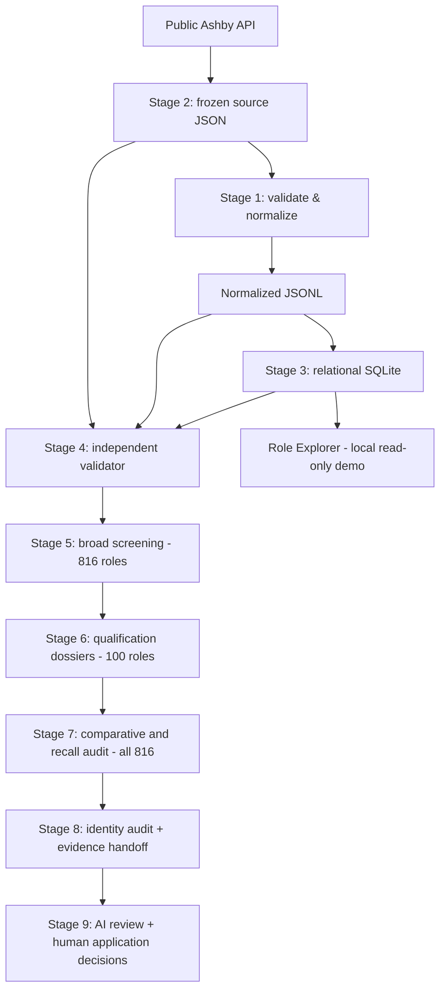

# Building My Way Into AI

> **Breaking into the AI industry one real application at a time.**

**ProofLoop** is a human-directed, AI-assisted engineering project developed *inside* a real job application campaign. Attempt #001 uses OpenAI's public Ashby job-board data to turn a large and uncertain job search into a traceable workflow: collect source evidence, transform and store it, validate it independently, investigate candidates, challenge the analysis, and hand off complete evidence for human/AI review.

**Current stage:** Eight engineering/analysis stages completed and validated on Windows; an initial Stage 9 prompt-driven review has been performed. A local **Role Explorer demo** is included. The five roles are *selected application targets*, not proof that an employer has accepted an application or that requirements are met.

## At a glance

| Evidence | October 2026 results | Boundary |
| --- | ---: | --- |
| Live Ashby source snapshot | **816** postings | Frozen dataset, not a current availability guarantee |
| SQLite database | **816** stored roles | Stage 3 build; raw/canonical/provenance retained |
| Deep qualification review | **100** dossiers | Evidence overlap does not certify fit |
| Additional recall-audit leads | **175** | Revisit flags, not 175 qualified matches |
| Automated Windows tests (Stages 1–8) | **231 passed** | Corrected Stage 4 and replacement Stage 8 v0.8.1 |
| Role Explorer tests (new demo) | **19 local tests passed** | Verify separately on Windows before publishing a badge |

The **older HTML/Google Docs ingestion branch** produced a distinct dataset with **817 roles** and a different `proofloop.db` SQLite database. It is relevant to the learning history, but **not** the production Stage 3 database described in the current API pipeline. An earlier historical Ashby snapshot contained 815 postings; the subsequent live snapshot contained 816.

## Start the Role Explorer immediately (real 25-role excerpt)

This repository ships a small **genuine 25-role excerpt** of the 816-role frozen Stage 3 database, preserving the real relational schema and original provenance. The full 816-role database remains available in the local project, but the compact excerpt keeps this source repository fast to clone. Run from the repository root:

```powershell
python .\app\proofloop_explorer.py --db '.\examples\openai_snapshot_25.sqlite3' --open
```

The included excerpt contains **25 actual historical OpenAI posting records**, including the five selected targets; it is not a live job feed and does not assert job availability. If you have the locally generated full dataset, run the command in [`docs/demo.md`](docs/demo.md) to explore the actual 816-role SQLite database.

## Three-layer project

| Layer | Present evidence |
| --- | --- |
| **Engineering** | HTML prototypes (817 records); API pipeline (816), JSON/JSONL, CSV, SQLite, independent validation, analytical stages, 231 validated Windows tests |
| **Product / interface** | Read-only searchable local Role Explorer with role inspection, filtering, sort, source/provenance views; 25 genuine records in the included public demo |
| **Proof / portfolio** | README, architecture, data model, test history, development log, 20 preserved pre-Git scripts, Git commits created now, project lessons and application campaign documentation |

**Development philosophy:** Every next milestone should generate both working product and presentable evidence. A GitHub repository is one such evidence artifact, not the end of ProofLoop.

## What it does



The order of **implementation** began at Stage 1, but the runtime data flow is **Stage 2 → Stage 1 → Stage 3**.

## Try the local role explorer

Requires Python 3.10+ and your **existing, generated** Stage 3 SQLite file. It uses only the Python standard library and does not mutate the database.

From the `FinalVersion` directory in PowerShell 7:

```powershell
python .\app\proofloop_explorer.py --db '.\runs\openai_live_sqlite_001\db\jobs.sqlite3' --open
```

The app opens on `http://127.0.0.1:8765/`. Search/filter/sort postings, inspect the full job description, and open original source links. Press Ctrl+C to stop. No API key, package installation, internet connection, or public deployment required. **Do not treat the `is_remote` metadata as proof of Utah remote eligibility.**

Run the demo's independent regression suite:

```powershell
python -m unittest discover -s tests -p test_role_explorer.py -v
```

See [the demo guide](docs/demo.md) for SQL examples, screenshots to capture, and limitations.

## Engineering stages

| Stage | Module | Role | Windows tests passed |
| --- | --- | --- | ---: |
| 1 | `proofloop_normalize.py` | Offline structural validation + canonical JSONL | 17 |
| 2 | `proofloop_fetch.py` | Fetch/freeze public Ashby source | 23 |
| 3 | `proofloop_store.py` | Relational SQLite build with provenance | 24 |
| 4 | `proofloop_validate.py` | Independent source/JSONL/DB validation | 26 |
| 5 | `proofloop_broad.py` | Transparent broad triage | 24 |
| 6 | `proofloop_deep.py` | Qualification extraction + uncertainty | 30 |
| 7 | `proofloop_advanced.py` | Comparative analysis + full-corpus recall | 40 |
| 8 | `proofloop_handoff.py` | Cross-stage audit + complete AI evidence archive | 47 |

**Total: 231**. These are the latest corrected local suites; failed historical test runs remain part of the development history rather than being silently erased. Stage 8 was replaced with **v0.8.1**, because the earlier handoff omitted the résumé-based candidate evidence needed for independent comparison. Tests use simulated cases and do not certify real-world hiring suitability or current posting status.

Stage 9 is a reusable **AI prompt and human decision step**, not another Python ETL module. AI review uses the Stage 8 `ai_handoff_bundle.zip`; no generated AI output should override original employer evidence.

## OpenAI Attempt #001

The original application targets (001-A / 001-B / 001-C) remained in the eventual five-target discussion. The two additional choices emphasized the user's interest in remote work, while accepting that both have substantial qualifications uncertainty.

For candidate job IDs, direct application URLs, status and caveats, see [Attempt #001](docs/attempt_001.md). **Role selection does not mean application submission**. No current posting status or work-from-Utah eligibility is guaranteed by historical snapshots.

## Documentation

- [Architecture](docs/architecture.md) — stage boundaries, original vs derived evidence, local demo
- [Data model](docs/data_model.md) — JSONL, SQLite schema, provenance and constraints
- [Validation and testing](docs/validation_and_testing.md) — verified test history, failures and safeguards
- [Attempt #001](docs/attempt_001.md) — five selected application targets and evidence limits
- [Development log](docs/development_log.md) — authentic progression, not fabricated Git history
- [Lessons learned](docs/lessons_learned.md) — engineering failures and improvements
- [Screening methodology](docs/screening_method.md) — no-sales, remote eligibility, qualifications and fit-versus-keywords
- [Demo](docs/demo.md) — run the genuine 25-posting interface demo and capture portfolio evidence
- [Stage 9 prompt](docs/stage9_initial_ai_prompt.md) — portable AI review instructions
- [Real demo excerpt provenance](examples/SAMPLE_SOURCE.md) — source scope and limits
- [Portfolio evidence](docs/portfolio_evidence.md) — what to show publicly and what not to claim
- [Git preparation](docs/git_plan.md) — staged historical/current milestone commits and GitHub publication

## Repository boundaries

This is a **curated source repository**, not a dump of all local execution outputs. `.gitignore` keeps repeated run files, archives, virtual environments, and bulk datasets out of normal commits for **repository size and reproducibility**, not because the user has prohibited sharing their professional information. The contact-redacted résumé claims may be committed as project context if desired. You can publish additional files deliberately later.

A minimal credentials check before public push remains sensible; it is unrelated to general personal-information restrictions. No files or commits change just by reading the documentation.

## Development philosophy

This project is being built from the beginning, one real application at a time. Engineering output and demonstrable evidence should advance together. It is legitimate to describe AI assistance; do not present AI-generated code as solely handwritten, or project exposure as years of production experience. The strongest evidence is reproducible behavior, test results, documented tradeoffs and an honest explanation of what was learned.
