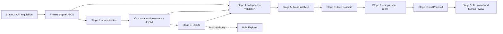

# Architecture — source to evidence to application decisions

## Current supported chain

**Implementation order** started with an offline normalizer (Stage 1) and only then implemented fetch (Stage 2). **Runtime data flow** begins with acquisition (Stage 2) and then normalization (Stage 1).

## Boundaries and design decisions

- **Acquisition (Stage 2)** freezes exact source HTTP response bytes, counts records and produces an acquisition report. No qualification decisions.
- **Normalization (Stage 1)** preserves raw job objects alongside canonical fields and per-record provenance. Distinguishes absent/null remote values rather than inventing defaults.
- **Storage (Stage 3)** persists canonical and raw JSON plus normalized relational child tables, retains SHA fingerprints and supports predictable querying. Does not change source records.
- **Independent verification (Stage 4)** compares stages; it does not merely trust the importer saying “PASS.”
- **Broad investigation (Stage 5)** screens all 816 without confusing remote metadata or sales-adjacent words with eligibility/sales duties.
- **Deep evidence (Stage 6)** extracts qualification statements and marks candidate overlap as provisional; unverified years and degrees remain unknown.
- **Comparative/recall (Stage 7)** audits all 816, including the 716 outside the first 100 dossiers, and flags 175 for further consideration. Flags are not recommendations.
- **Handoff audit (Stage 8 v0.8.1)** checks identities, supplies all original descriptions and Stage 5–8 reports, and includes contact-sanitized structured candidate evidence and résumé transcription with clear unverified status.
- **Stage 9** uses a reusable AI analysis prompt; a human retains control over interpretation, selection and actual applications. A transcript is not required as a dependency for running the pipeline.

## Alternate historical branch

The first learning branch used a Google Docs **HTML export**, not a public API fetch, to preserve hyperlinks for 817 listings. It explored HTML parsing, JSONL, CSV, SQLite and a later reconciliation against a separate 815-job Ashby snapshot. This historical data branch is documented but **not** the same as the live 816-posting Stage 3 database.

## Product interface

`app/proofloop_explorer.py` is an **additive** local HTTP interface reading the Stage 3 SQLite database in read-only mode. It offers searchable, paginated role listings, team/workplace/remote filters, original source links, complete role descriptions and canonical/provenance inspection.

The demo binds to `127.0.0.1` and has no authentication. It is **not** intended for public Internet deployment. Work arrangement metadata is presented as originally captured, not asserted as Utah-specific remote eligibility.

Future features may overlay Stage 5–8 classifications, maintain a separate application ledger, allow explicit human corrections, and link to Git proof artifacts. None of those are claimed implemented by this first explorer.
