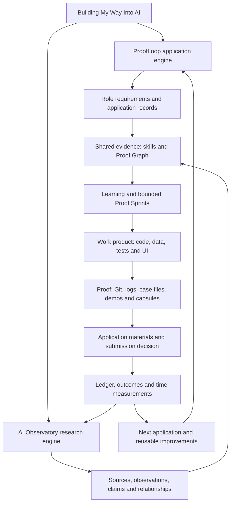

# Architecture — one journey, multiple components, one evidence loop

## Distinct layers

- **Journey / campaign:** Building My Way Into AI, the public narrative and measured longitudinal experiment.
- **ProofLoop:** employer role → source requirements → self-reported professional experience and verifiable project evidence → missing ability vs missing evidence → just-in-time learning → bounded Proof Sprint → application → outcome.
- **AI Observatory:** company → source → observation → evidence-classified claim → relationships and unknowns → case files → industry findings.
- **Shared continuity:** Application Ledger, source/evidence identifiers, skill states, Proof Graph, build log, project-management decisions, demonstrations and time/efficiency metrics.
- **Engineering:** physical `Day1` folder with 817-role HTML prototype and `Day1/FinalVersion` with a distinct 816-role API pipeline, Stage 9 AI-review prompt, tests, SQLite and Role Explorer.

## Current minimum implementation

`framework/ledgers/` contains small human-reviewable CSV records; `observatory/companies/openai/` contains the first sourced case; `Day1/ATTEMPT_OVERVIEW.md` describes Attempt #001 with five shortlisted targets and no verified submissions. **IDs join records** without requiring an elaborate new database before applying. Production-grade migrations, graph visualization, automated model APIs, public hosting and video publishing are *later*, not required to complete initial applications.

## Evidence chain

`target_id` → `requirement_id` (wording and source) → `proof_graph` (`evidence_id`, state and gap) → `evidence.csv` (artifact + limitation) → `skills.csv` and build/test logs → actual application event. `sources.csv` and `observations.csv` provide the research side. Use original source wording when available; a heuristic score is not proof.

## The two snapshots must not be conflated

The historic `Day1/proofloop.db` stems from an HTML experiment with 817 role rows; the later `Day1/FinalVersion` pipeline has an independent 816-role Ashby API snapshot. These are different captures, not evidence of 1,633 unique jobs.

**The physical folder is `Day1`, not `Attempt1`.** The first case remains logical Attempt #001 despite its multi-day development period. Future attempts will inherit, rather than fork, this root framework.
